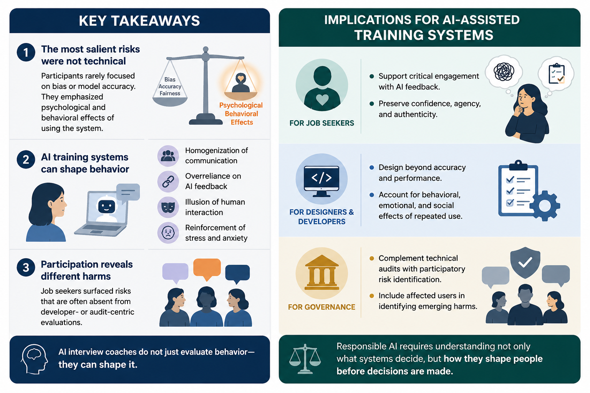

    
✅

    

        <strong>Four User-Identified Psychological Risks</strong>
        

            Through participatory workshops with N=20 job seekers, this work uncovered four experiential and psychological harms overlooked by model-centric fairness evaluations:
        

        <ul style="margin: 8px 0 0 18px; font-size: 14px; line-height: 1.5;">
            <li><strong>Homogenization of Communication:</strong> Pressure to conform to rigid algorithmic speech and behavioural templates.</li>
            <li><strong>Overreliance on AI:</strong> Erode personal agency by treating automated suggestions as infallible truth.</li>
            <li><strong>Illusion of Human Interaction:</strong> Uncanny mismatch when artificial agents mimic human empathy without genuine comprehension.</li>
            <li><strong>Reinforcement of Stress &amp; Anxiety:</strong> Continuous algorithmic scoring heightening evaluation apprehension.</li>
        </ul>
    

<h3>Abstract</h3>

    AI-assisted interview hiring and training systems are increasingly positioned as tools to support job seekers; however, their deployment may introduce risks that are not sufficiently understood. Existing research on fairness and accountability in AI systems has largely emphasized model-centric harms, often overlooking how affected users themselves perceive and articulate risks.

    We present a participatory study that centers job seekers' perspectives on the potential harms of AI-assisted interview training systems. Through a workshop with N=20 job seekers, participants engaged in collective reflection and peer critique of proposed AI-driven feedback designs. An inductive thematic analysis of participants' evaluative feedback reveals four psychological risks: homogenization of communication, overreliance on AI, illusion of human interaction, and reinforcement of stress and anxiety. These risks highlight the experiential and psychological harms that can arise from AI-mediated training. By foregrounding job seekers as active contributors to risk identification, this work contributes a user-centered perspective on AI harms and underscores the importance of participatory approaches for anticipating and mitigating risks in AI-enabled hiring and training systems.

<figure>
    
    <figcaption>Figure 1: Participatory identification framework and user-centered risk taxonomy in AI-assisted interview training.</figcaption>
</figure>

<h3>Paper &amp; Citation</h3>

    

        <strong>Pooja S. B. Rao</strong>, Laxminarayen Nagarajan Venkatesan, Dinesh Babu Jayagopi, and Mauro Cherubini. 2026. <em>“Robotic Answers”: Participatory Identification of Risks in AI-Assisted Interview Training by Job Seekers</em>. In Proceedings of the 2026 ACM Conference on Fairness, Accountability, and Transparency (FAccT ’26).
    

    

        <a href="https://doi.org/10.1145/3805689.3812234" target="_blank" rel="noopener noreferrer" class="btn-primary" style="font-size: 13px; height: 36px;">
            Access Paper via ACM Digital Library (DOI) &nearr;
        </a>
    

