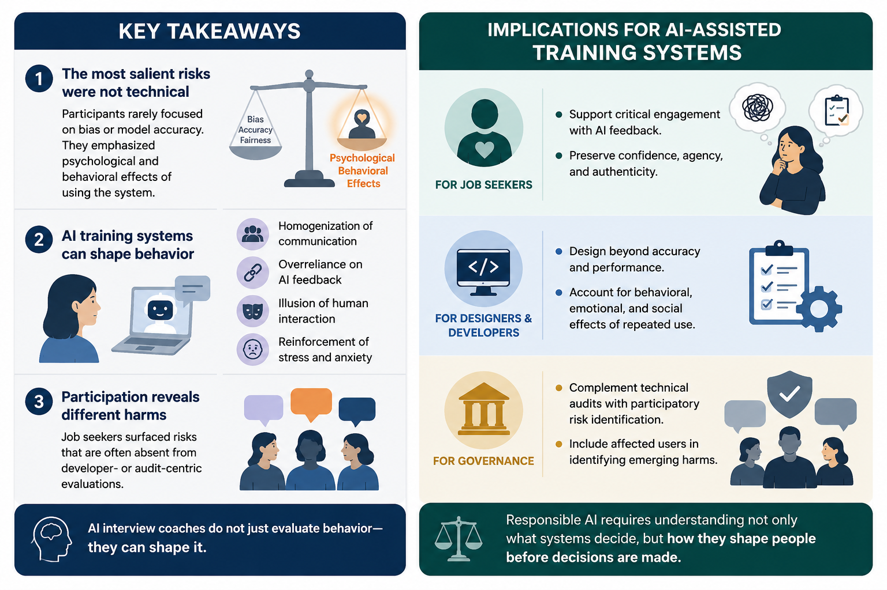
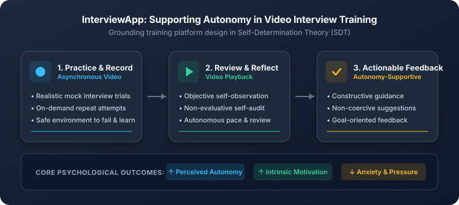
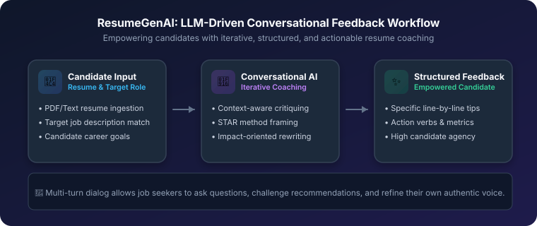
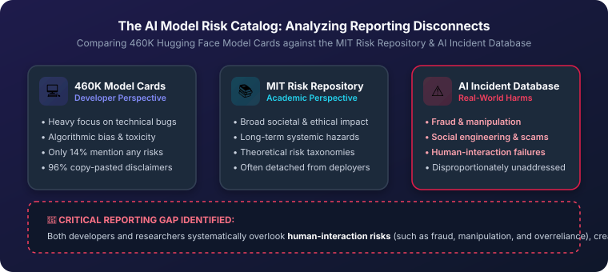
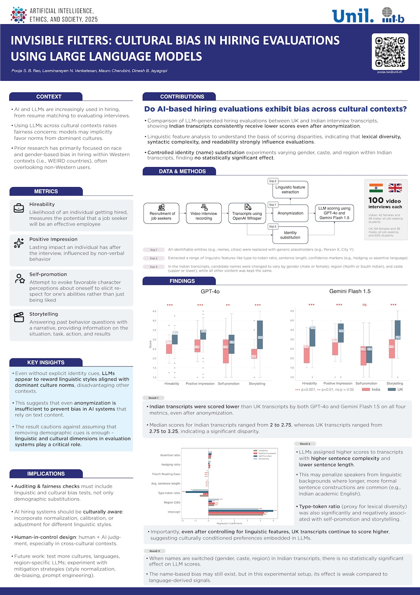
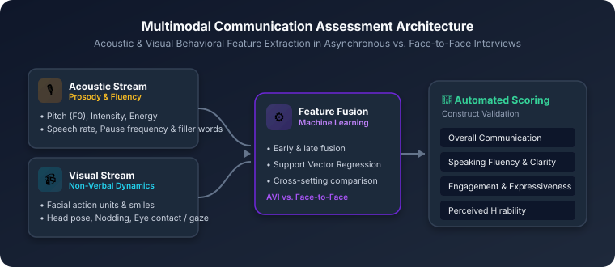
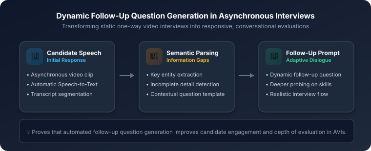

<!-- Subsection 1: Human-Centred Design & Evaluation -->

<h3 class="research-subsection-title">
<svg xmlns="http://www.w3.org/2000/svg" width="22" height="22" viewBox="0 0 24 24" fill="none" stroke="currentColor" stroke-width="2" stroke-linecap="round" stroke-linejoin="round" style="color: var(--bullet-color);"><path d="M17 21v-2a4 4 0 0 0-4-4H5a4 4 0 0 0-4 4v2"></path><circle cx="9" cy="7" r="4"></circle><path d="M23 21v-2a4 4 0 0 0-3-3.87"></path><path d="M16 3.13a4 4 0 0 1 0 7.75"></path></svg>
Human Centred Design and Evaluation of AI Assisted Interview Systems
</h3>

Investigating how artificial intelligence can be intentionally designed around human psychological needs rather than rigid automation. Grounded in Self-Determination Theory (SDT) and participatory co-design methodologies, this research explores how job seekers experience, perceive, and learn from AI-driven interview preparation platforms. By centering affected users throughout the design lifecycle, these works uncover critical experiential tensions—such as the risk of producing homogenized "robotic answers"—and demonstrate how structured practice, video playback, and autonomy-supportive conversational feedback can genuinely empower candidates.

<!-- Paper 1.1: Robotic Answers (FAccT 2026) -->

<h4 class="paper-title">
<a href="https://doi.org/10.1145/3805689.3812234" target="_blank" rel="noopener noreferrer">
Robotic Answers: Participatory Identification of Risks in AI-Assisted Interview Training by Job Seekers
</a>
</h4>

<strong>Pooja S. B. Rao</strong>, Laxminarayen Nagarajan Venkatesan, Dinesh Babu Jayagopi, and Mauro Cherubini

ACM FAccT 2026
Participatory Co-Design
Psychological Risks

Participatory Risk Framework: Centering job seekers' perspectives to uncover psychological harms in AI interview training.

Abstract

AI-assisted interview hiring and training systems are increasingly positioned as tools to support job seekers; however, their deployment may introduce risks that are not sufficiently understood. Existing research on fairness and accountability in AI systems has largely emphasized model-centric harms, often overlooking how affected users themselves perceive and articulate risks. We present a participatory study that centers job seekers' perspectives on the potential harms of AI-assisted interview training systems. Through a workshop with N=20 job seekers, participants engaged in collective reflection and peer critique of proposed AI-driven feedback designs. An inductive thematic analysis reveals four psychological risks: <em>homogenization of communication ("robotic answers")</em>, <em>overreliance on AI</em>, <em>illusion of human interaction</em>, and <em>reinforcement of stress and anxiety</em>. By foregrounding job seekers as active contributors to risk identification, this work provides a user-centered perspective on AI harms in hiring technologies.

<a href="https://doi.org/10.1145/3805689.3812234" target="_blank" rel="noopener noreferrer">📄 ACM Digital Library</a>
<a href="/participatory-risks-facct/">📑 Project Page</a>

<!-- Paper 1.2: Supporting Autonomy (IJHCS 2024) -->

<h4 class="paper-title">
<a href="https://doi.org/10.1016/j.ijhcs.2024.103326" target="_blank" rel="noopener noreferrer">
On the Potential of Supporting Autonomy in Online Video Interview Training Platforms
</a>
</h4>

<strong>Pooja S. B. Rao</strong>, Laetitia Renier, Marc-Olivier Boldi, Marianne S. Mast, Dinesh B. Jayagopi, and Mauro Cherubini

IJHCS 2024
Self-Determination Theory
User Evaluation

InterviewApp Framework: Supporting candidate autonomy, competence, and self-efficacy through mock recording, playback, and structured feedback.

Abstract

Asynchronous video interviews (AVIs) have become standard in recruitment, yet preparing for them often induces high anxiety and feelings of depersonalization. This study introduces <em>InterviewApp</em>, an online interview training platform built upon Self-Determination Theory (SDT). Across experimental interventions with job seekers, we investigate how structured mock interview recordings, video playback self-reflection, and autonomy-supportive expert feedback influence interview performance and motivation. Our findings demonstrate that perceived autonomy plays a decisive mediating role: empowering candidates with control over their training pace and non-evaluative self-reflection significantly enhances interview performance and self-efficacy while mitigating anxiety, pointing to key design guidelines for autonomy-supportive career preparation systems.

<a href="https://doi.org/10.1016/j.ijhcs.2024.103326" target="_blank" rel="noopener noreferrer">📄 IJHCS Article</a>
<a href="https://iris.unil.ch/entities/publication/d99651f9-3551-41e4-99e0-563db36ab034" target="_blank" rel="noopener noreferrer">🎓 PhD Thesis Chapter</a>

<!-- Paper 1.3: ResumeGenAI (CUI 2025) -->

<h4 class="paper-title">
<a href="https://doi.org/10.1145/3719160.3737622" target="_blank" rel="noopener noreferrer">
ResumeGenAI: Supporting Job Seekers with LLM-Driven Resume Feedback
</a>
</h4>

Dhruv Awasthi, <strong>Pooja S. B. Rao</strong>, and Dinesh Babu Jayagopi

ACM CUI 2025
Conversational AI
LLM Feedback

ResumeGenAI Workflow: Conversational, multi-turn LLM guidance supporting candidate agency and structured resume improvements.

Abstract

Resume screening is frequently candidates' first gate in automated hiring pipelines, yet feedback on rejected resumes remains virtually non-existent. We present <em>ResumeGenAI</em>, a conversational AI system designed to provide job seekers with transparent, personalized, and actionable resume feedback. By combining role-targeted criteria analysis with multi-turn conversational interaction, ResumeGenAI enables candidates to discuss critique points, test rewording suggestions, and maintain authentic ownership of their qualifications, bridging the gap between automated screening standards and job seeker empowerment.

<a href="https://doi.org/10.1145/3719160.3737622" target="_blank" rel="noopener noreferrer">📄 ACM Digital Library</a>

<!-- Subsection 2: Responsible Risk Identification & Reporting -->

<h3 class="research-subsection-title">
<svg xmlns="http://www.w3.org/2000/svg" width="22" height="22" viewBox="0 0 24 24" fill="none" stroke="currentColor" stroke-width="2" stroke-linecap="round" stroke-linejoin="round" style="color: var(--bullet-color);"><path d="M10.29 3.86L1.82 18a2 2 0 0 0 1.71 3h16.94a2 2 0 0 0 1.71-3L13.71 3.86a2 2 0 0 0-3.42 0z"></path><line x1="12" y1="9" x2="12" y2="13"></line><line x1="12" y1="17" x2="12.01" y2="17"></line></svg>
Responsible Risk Identification and Reporting
</h3>

Interrogating how artificial intelligence risks, socio-technical hazards, and algorithmic biases are communicated, audited, and mitigated across the AI development lifecycle. This research combines large-scale empirical auditing of over 460,000 open-source model cards, retrieval-augmented generation tools (RiskRAG) for actionable risk reporting, and experimental fairness auditing of Large Language Models in recruitment. By identifying severe blind spots between what developers report and how AI causes real-world harm, this work contributes practical solutions for transparent, culturally sensitive, and accountable AI systems.

<!-- Paper 2.1: RiskRAG (CHI 2025) - TALK AVAILABLE -->

<h4 class="paper-title">
<a href="https://doi.org/10.1145/3706598.3713979" target="_blank" rel="noopener noreferrer">
RiskRAG: A Data-Driven Solution for Improved AI Model Risk Reporting
</a>
</h4>

<strong>Pooja S. B. Rao</strong>, Sanja Šćepanović, Ke Zhou, Edyta Paulina Bogucka, and Daniele Quercia

ACM CHI 2025

<svg xmlns="http://www.w3.org/2000/svg" width="12" height="12" viewBox="0 0 24 24" fill="currentColor"><path d="M21.582 6.186a2.506 2.506 0 0 0-1.768-1.77C18.254 4 12 4 12 4s-6.254 0-7.814.416a2.506 2.506 0 0 0-1.768 1.77C2 7.748 2 12 2 12s0 4.252.418 5.814a2.506 2.506 0 0 0 1.768 1.77C5.746 20 12 20 12 20s6.254 0 7.814-.416a2.506 2.506 0 0 0 1.768-1.77C22 16.252 22 12 22 12s0-4.252-.418-5.814zM10 15.5V8.5l6 3.5-6 3.5z"/></svg>
Talk Available

Retrieval-Augmented Generation

<!-- Video Thumbnail Card -->

<a href="https://www.youtube.com/watch?v=vJ8lHE9DB4g" target="_blank" rel="noopener noreferrer" class="video-thumbnail-wrapper" title="Watch RiskRAG Talk on YouTube">

<svg viewBox="0 0 24 24"><path d="M8 5v14l11-7z"/></svg>

Watch ACM CHI 2025 Presentation

</a>

Conference presentation of RiskRAG at ACM CHI 2025: Data-driven AI model risk reporting.

Abstract

Risk reporting is essential for documenting AI models, yet only 14% of model cards mention risks, out of which 96% copy content from a small set of cards, leading to a critical lack of actionable insights. To address this, we introduce <em>RiskRAG</em>, a Retrieval-Augmented Generation (RAG) based risk reporting solution guided by five design requirements co-designed with 16 developers: identifying diverse model-specific risks, clearly presenting and prioritizing them, contextualizing for real-world uses, and offering concrete mitigation strategies. Drawing from 450K model cards and 600 real-world incidents, RiskRAG pre-populates contextualized risk reports. Evaluated with 115 practitioners across development, design, and media, RiskRAG significantly improved AI model selection, fostering more deliberative and safety-conscious deployment choices.

<a href="https://doi.org/10.1145/3706598.3713979" target="_blank" rel="noopener noreferrer">📄 ACM Digital Library</a>
<a href="https://arxiv.org/abs/2504.08952" target="_blank" rel="noopener noreferrer">📑 arXiv:2504.08952</a>
<a href="https://www.youtube.com/watch?v=vJ8lHE9DB4g" target="_blank" rel="noopener noreferrer">▶️ Watch Talk (YouTube)</a>

<!-- Paper 2.2: AI Model Risk Catalog (AIES 2025) -->

<h4 class="paper-title">
<a href="https://doi.org/10.1609/aies.v8i3.36702" target="_blank" rel="noopener noreferrer">
The AI Model Risk Catalog: What Developers and Researchers Miss About Real-World AI Harms
</a>
</h4>

<strong>Pooja S. B. Rao</strong>, Sanja Šćepanović, Dinesh Babu Jayagopi, Mauro Cherubini, and Daniele Quercia

AAAI/ACM AIES 2025
Risk Taxonomy
460K Model Audit

The AI Model Risk Catalog: Comparative taxonomy revealing severe underreporting of fraud, manipulation, and human-interaction harms.

Abstract

We analyzed nearly 460,000 AI model cards from Hugging Face to examine how developers report risks in practice. From these, we extracted approximately 3,000 unique risk mentions and synthesized the <em>AI Model Risk Catalog</em>. Comparing developer-reported risks with those documented in academic taxonomies (MIT Risk Repository) and verified historical harms from the AI Incident Database revealed substantial misalignments: developers focus heavily on internal technical defects and basic bias, whereas researchers prioritize broad societal impacts. Alarmingly, both groups systematically overlook risks tied to fraud, deception, and social manipulation—harms that frequently emerge once AI systems interact with human users.

<a href="https://doi.org/10.1609/aies.v8i3.36702" target="_blank" rel="noopener noreferrer">📄 AAAI Proceedings</a>
<a href="/risk-catalog/">📑 Project Page</a>

<!-- Paper 2.3: Invisible Filters (AIES 2025) -->

<h4 class="paper-title">
<a href="https://doi.org/10.1609/aies.v8i3.36703" target="_blank" rel="noopener noreferrer">
Invisible Filters: Cultural Bias in Hiring Evaluations Using Large Language Models
</a>
</h4>

<strong>Pooja S. B. Rao</strong>, Laxminarayen Nagarajan Venkatesan, Mauro Cherubini, and Dinesh Babu Jayagopi

AAAI/ACM AIES 2025
Algorithmic Fairness
Cross-Cultural Evaluation

Research Poster: Investigating cultural bias and linguistic scoring disparities in LLM-assisted hiring evaluations.

Abstract

Large language models (LLMs) are increasingly deployed to screen and score interview candidates, raising critical questions of fairness across diverse cultural backgrounds. Using balanced datasets of video interview transcripts from UK and Indian job seekers, we evaluate cross-cultural differences in LLM-generated ratings for hirability, self-promotion, and storytelling. Indian candidates consistently receive lower evaluations, even when transcripts are completely anonymized. Disparities correlate strongly with linguistic style indicators—such as syntactic complexity and lexical diversity—rather than surface identity markers (names, gender, or caste). These findings demonstrate that standard LLMs harbor covert cultural evaluation filters, emphasizing the necessity of culturally grounded audits in AI hiring.

<a href="https://doi.org/10.1609/aies.v8i3.36703" target="_blank" rel="noopener noreferrer">📄 AAAI Proceedings</a>
<a href="https://arxiv.org/abs/2508.16673" target="_blank" rel="noopener noreferrer">📑 arXiv:2508.16673</a>
<a href="/assets/AIES-2025-Poster-1-Final.pdf" target="_blank" rel="noopener noreferrer">📊 Poster (PDF)</a>
<a href="/hiring-bias/">📑 Project Page</a>

<!-- Subsection 3: Good Research Practices -->

<h3 class="research-subsection-title">
<svg xmlns="http://www.w3.org/2000/svg" width="22" height="22" viewBox="0 0 24 24" fill="none" stroke="currentColor" stroke-width="2" stroke-linecap="round" stroke-linejoin="round" style="color: var(--bullet-color);"><path d="M12 2l3.09 6.26L22 9.27l-5 4.87 1.18 6.88L12 17.77l-6.18 3.25L7 14.14 2 9.27l6.91-1.01L12 2z"></path></svg>
Good Research Practices
</h3>

Advancing scientific transparency, methodological rigor, and research ethics across empirical computing and Human-Computer Interaction literature. Through large-scale meta-research, rigorous multi-annotator audits, and the development of automated verification tools, this work measures community-wide adherence to open science principles—including open data and code availability, ethical consent disclosures, participant compensation reporting, and experimental reproducibility.

<!-- Paper 3.1: Changes in Research Ethics (CHI 2023) - TALK AVAILABLE & BEST PAPER -->

<h4 class="paper-title">
<a href="https://doi.org/10.1145/3544548.3580848" target="_blank" rel="noopener noreferrer">
Changes in Research Ethics, Openness, and Transparency in Empirical Studies between CHI 2017 and CHI 2022
</a>
</h4>

Kavous S. Niksirat, Lahari Goswami, <strong>Pooja S. B. Rao</strong>, James Tyler, Alessandro Silacci, Sadiq Aliyu, Annika Aebli, Chat Wacharamanotham, and Mauro Cherubini

🏆 Best Paper Award (Top 1%)
ACM CHI 2023

<svg xmlns="http://www.w3.org/2000/svg" width="12" height="12" viewBox="0 0 24 24" fill="currentColor"><path d="M21.582 6.186a2.506 2.506 0 0 0-1.768-1.77C18.254 4 12 4 12 4s-6.254 0-7.814.416a2.506 2.506 0 0 0-1.768 1.77C2 7.748 2 12 2 12s0 4.252.418 5.814a2.506 2.506 0 0 0 1.768 1.77C5.746 20 12 20 12 20s6.254 0 7.814-.416a2.506 2.506 0 0 0 1.768-1.77C22 16.252 22 12 22 12s0-4.252-.418-5.814zM10 15.5V8.5l6 3.5-6 3.5z"/></svg>
Talk Available

Open Science

<!-- Video Thumbnail Card -->

<a href="https://www.youtube.com/watch?v=Pj1Gq805k8Y" target="_blank" rel="noopener noreferrer" class="video-thumbnail-wrapper" title="Watch ACM CHI 2023 Best Paper Presentation">

<svg viewBox="0 0 24 24"><path d="M8 5v14l11-7z"/></svg>

Watch ACM SIGCHI Award Presentation

</a>

ACM SIGCHI Conference presentation: Meta-evaluating 245 empirical papers across 45 good research practice criteria.

Abstract

In recent years, the Human-Computer Interaction (HCI) community has increasingly embraced Good Research Practices (GRPs) to improve the reliability, replicability, and ethical soundness of empirical findings. To examine the real-world impact of these initiatives, we conducted a meta-analysis evaluating stratified random samples of empirical papers from CHI 2017 (N=118) and CHI 2022 (N=127) across 45 operationalized criteria covering research ethics, openness, and transparency. The CHI 2022 sample demonstrated statistically significant improvements in 18 out of 45 criteria, with the strongest progress observed in <em>research transparency</em> (10 of 17 criteria). To support authors and reviewers in upholding these standards, we developed a proof-of-concept automated screening tool that accurately flags adherence for key criteria, providing a foundation for scalable meta-science in computing.

<a href="https://doi.org/10.1145/3544548.3580848" target="_blank" rel="noopener noreferrer">📄 ACM Digital Library</a>
<a href="https://doi.org/10.17605/osf.io/n25d6" target="_blank" rel="noopener noreferrer">📦 OSF Repository &amp; Dataset</a>
<a href="https://www.youtube.com/watch?v=Pj1Gq805k8Y" target="_blank" rel="noopener noreferrer">▶️ Watch Award Talk (YouTube)</a>

<!-- Subsection 4: Automated Interview Assessment -->

<h3 class="research-subsection-title">
<svg xmlns="http://www.w3.org/2000/svg" width="22" height="22" viewBox="0 0 24 24" fill="none" stroke="currentColor" stroke-width="2" stroke-linecap="round" stroke-linejoin="round" style="color: var(--bullet-color);"><path d="M14 2H6a2 2 0 0 0-2 2v16a2 2 0 0 0 2 2h12a2 2 0 0 0 2-2V8z"></path><polyline points="14 2 14 8 20 8"></polyline><line x1="16" y1="13" x2="8" y2="13"></line><line x1="16" y1="17" x2="8" y2="17"></line><polyline points="10 9 9 9 8 9"></polyline></svg>
Automated Interview Assessment
</h3>

Pioneering multimodal machine learning and computational behavioral analysis to assess non-verbal communication, speaking fluency, and interaction dynamics in video interviews. Combining acoustic signal processing (pitch, rhythm, pause structures), visual non-verbal tracking (head pose, gaze, facial action units), and natural language processing, this body of work established foundational empirical baselines comparing asynchronous video interviews against traditional face-to-face formats, and introduced dynamic follow-up question generation to make automated interviews interactive and conversational.

<!-- Paper 4.1: AVI vs Face-to-Face (ICMI 2016) - BEST STUDENT PAPER NOMINEE -->

<h4 class="paper-title">
<a href="https://doi.org/10.1145/2993148.2993183" target="_blank" rel="noopener noreferrer">
Asynchronous Video Interviews vs. Face-to-Face Interviews for Communication Skill Measurement: A Systematic Study
</a>
</h4>

Sowmya Rasipuram, <strong>Pooja S. B. Rao</strong>, and Dinesh B. Jayagopi

🏆 Best Student Paper Nominee
ACM ICMI 2016
Multimodal Signal Processing

Multimodal Assessment Architecture: Feature extraction across acoustic and visual modalities for automated communication skill scoring.

Abstract

Asynchronous video interviews (AVIs) have increasingly replaced traditional in-person interviews for preliminary hiring screening. However, how candidate behaviors and perceived communication competence translate across these distinct interaction modes remains poorly understood. In this systematic comparative study, we collect synchronized audio-visual recordings of candidates participating in both AVIs and conventional face-to-face interviews. We extract multimodal non-verbal behavioral cues—including prosodic features, facial expressions, and head movements—and train regression models to automatically score communication skills. Our comparative analysis reveals that while acoustic features remain consistently predictive across both formats, visual engagement and expressive cues exhibit significant modality-specific variations that automated evaluation algorithms must account for.

<a href="https://doi.org/10.1145/2993148.2993183" target="_blank" rel="noopener noreferrer">📄 ACM Digital Library</a>

<!-- Paper 4.2: Dynamic Follow-up Question Generation (IJIMAI 2021) -->

<h4 class="paper-title">
<a href="http://doi.org/10.9781/ijimai.2021.02.010" target="_blank" rel="noopener noreferrer">
Improving Asynchronous Interview Interaction with Follow-up Question Generation
</a>
</h4>

<strong>Pooja S. B. Rao</strong>, Manish Agnihotri, and Dinesh B. Jayagopi

IJIMAI 2021
Natural Language Processing
Conversational Interaction

Adaptive Follow-Up Generation: Parsing candidate speech to identify information gaps and generate relevant follow-up questions in real time.

Abstract

A critical drawback of asynchronous video interviews is their rigid, one-sided nature: candidates respond to pre-recorded prompts without the opportunity for clarifying dialogue or deeper probing. We propose an automated natural language processing pipeline to incorporate dynamic follow-up question generation into asynchronous interviews. By transcribing candidate utterances in real time, extracting key named entities, and detecting incomplete thematic segments, the system formulates contextually grounded follow-up questions. User evaluations demonstrate that automated follow-up questions significantly increase interview realism, candidate engagement, and the depth of verifiable information obtained.

<a href="http://doi.org/10.9781/ijimai.2021.02.010" target="_blank" rel="noopener noreferrer">📄 IJIMAI Article</a>

<!-- Paper 4.3: Automatic Fluency Prediction (INDICON 2016) -->

<h4 class="paper-title">
<a href="https://doi.org/10.1109/INDICON.2016.7838991" target="_blank" rel="noopener noreferrer">
Automatic Prediction of Fluency in Interface-Based Interviews
</a>
</h4>

Sowmya Rasipuram, <strong>Pooja S. B. Rao</strong>, and Dinesh B. Jayagopi

IEEE INDICON 2016
Speech Analysis
Fluency Modeling

Abstract

Oral fluency is a crucial determinant of communication ratings in job interviews. In interface-based asynchronous interviews, speech is often affected by the unnatural interaction setting. We present an automated approach for predicting speaking fluency ratings using acoustic and temporal prosodic features extracted from interview audio, including syllable articulation rates, phonation-time ratios, pause length distributions, and pitch contours. Evaluated against expert human ratings, our machine learning models demonstrate high correlation with human assessors, validating speech prosody modeling as an effective component for scalable interview evaluation.

<a href="https://doi.org/10.1109/INDICON.2016.7838991" target="_blank" rel="noopener noreferrer">📄 IEEE Xplore</a>

